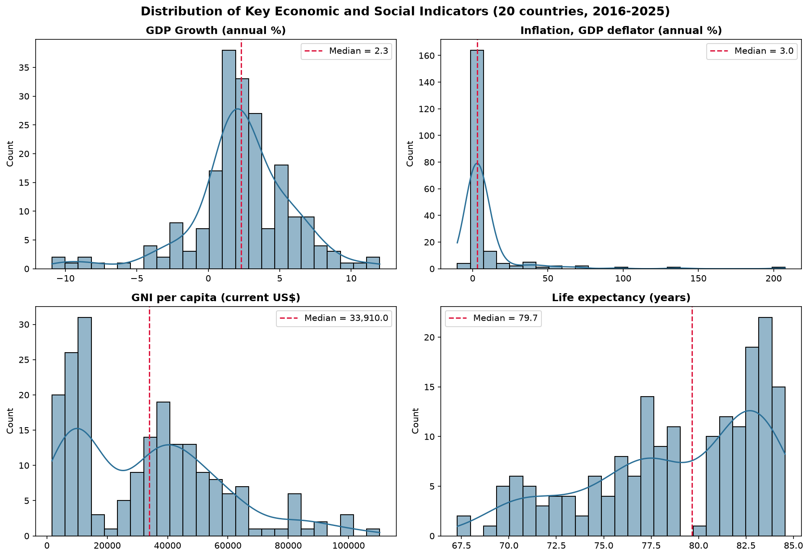
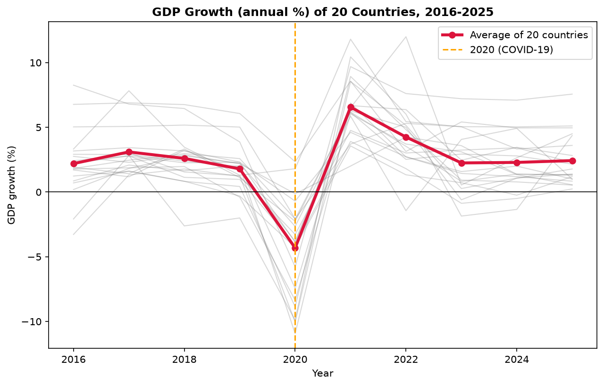
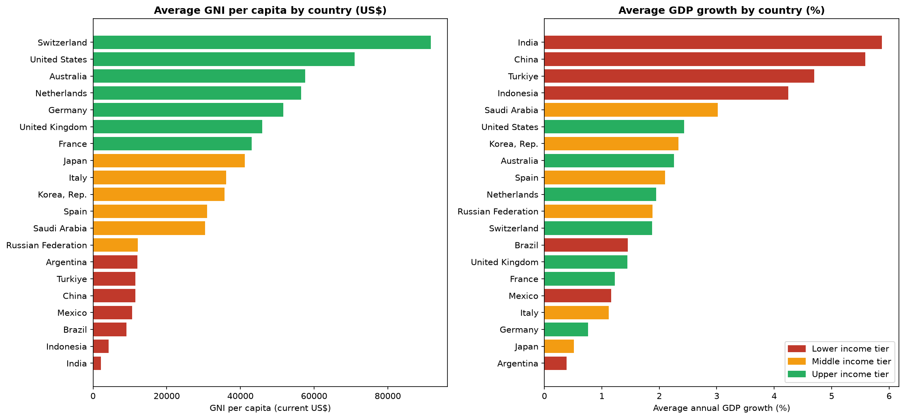
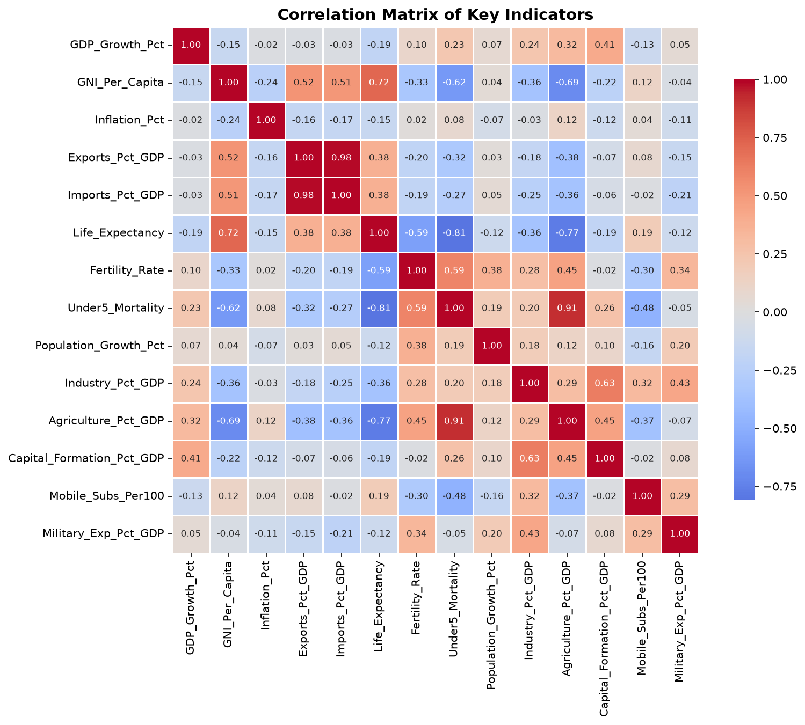

# Exploratory Data Analysis of Global Economic Indicators

A Python data analysis project that explores real World Bank data on the economies of 20 countries between 2016 and 2025, using Pandas, NumPy, Matplotlib and Seaborn in a Jupyter Notebook.

---

## Project Overview

| Item | Details |
|---|---|
| **Project Title** | Exploratory Data Analysis of Global Economic Indicators |
| **Industry Name** | [Add your industry name] |
| **Dataset** | World Development Indicators (WDI) extract |
| **Coverage** | 20 countries, 52 indicators, 2016-2025 |

---

## Problem Statement

[Add your real-world / industry problem statement here]

---

## Proposed Solution / Analysis Questions

The project cleans the World Bank data, reshapes it into an analysis-ready table, and answers the following questions using Python:

1. **Q1** - What is the distribution of GDP growth across country-years?
2. **Q2** - What is the average economic and social profile of each country (2016-2025)?
3. **Q3** - How did average GDP growth change over the years?
4. **Q4** - How did COVID-19 affect GDP growth (2019 vs 2020 vs 2021)?
5. **Q5** - Which values are outliers in inflation and GDP growth?
6. **Q6** - How do countries compare when grouped into income tiers?
7. **Q7** - Which indicators are most strongly correlated with each other?

---

## Dataset

- **Dataset Name:** World Development Indicators (WDI) data extract
- **Dataset Source:** World Bank DataBank - https://databank.worldbank.org/source/world-development-indicators
- **Last updated (as stated in the file):** 13 July 2026
- **Countries (20):** Argentina, Australia, Brazil, China, France, Germany, India, Indonesia, Italy, Japan, Korea Rep., Mexico, Netherlands, Russian Federation, Saudi Arabia, Spain, Switzerland, Turkiye, United Kingdom, United States
- **Raw file:** wide format (one column per year), 1,040 data rows plus 5 footer/blank rows; missing values are written as `..`

---

## Tools & Technologies

- Python
- Jupyter Notebook
- NumPy
- Pandas
- Matplotlib
- Seaborn
- Visual Studio Code

---

## Project Workflow

**Industry Selection → Problem Identification → Dataset Collection → Data Cleaning → Data Transformation → Data Analysis → Data Visualization → Insights → Recommendations**

| Stage | What was done |
|---|---|
| **Industry Selection** | [Add the industry you selected] |
| **Problem Identification** | [Add the problem you identified] |
| **Dataset Collection** | Downloaded the World Development Indicators extract from World Bank DataBank |
| **Data Cleaning** | Removed 5 footer/blank rows; converted the text `..` into real missing values; converted the year columns from text to numbers; renamed columns; checked for duplicates (none found) |
| **Data Transformation** | Reshaped the data from wide to long format (10,400 rows); built a country-year table of 16 selected indicators (200 rows); grouped GDP growth into categories with `pd.cut`; grouped countries into Lower / Middle / Upper income tiers with `pd.qcut` |
| **Data Analysis** | Summary statistics, missing-value check, country profiles, yearly trend, COVID-19 comparison, IQR outlier detection, income-tier comparison, correlation analysis |
| **Data Visualization** | Four charts: distribution, trend, category and correlation analysis |
| **Insights** | See *Key Insights* below |
| **Recommendations** | See *Recommendations* below |

---

## Data Analysis & Visualization

The following analysis and visualizations were performed in the notebook:

- **Distribution Analysis** - GDP growth grouped into four categories (with counts and percentages), and histograms of GDP growth, inflation, GNI per capita and life expectancy
- **Category-wise Analysis** - average profile of each country, and a comparison of Lower, Middle and Upper income tiers
- **Trend Analysis** - average, lowest and highest GDP growth for each year from 2016 to 2025, plotted for all 20 countries
- **Comparison Analysis** - COVID-19 impact on GDP growth (2019 vs 2020 vs 2021) for each country
- **Outlier Analysis** - IQR method applied to inflation and GDP growth
- **Correlation Analysis** - correlation matrix and heatmap of 14 indicators

---

## Key Insights

1. **Most country-years had positive growth.** Only 15.5% of the 200 country-years (31) were contractions, almost all of them in 2020.
2. **COVID-19 was the defining shock.** Average GDP growth fell from 1.79% in 2019 to -4.32% in 2020, then rebounded to +6.56% in 2021. Spain (-10.94%), the United Kingdom (-10.05%) and Argentina (-9.90%) fell the most in 2020. Only China (+2.34%) and Turkiye (+1.80%) still grew.
3. **Richer countries did not grow faster.** India (5.88%), China (5.59%) and Turkiye (4.70%) had the highest average growth; Argentina (0.39%), Japan (0.51%) and Germany (0.76%) had the lowest. The Lower income tier grew 3.34% a year against 1.70% for the Upper tier, and the correlation between GNI per capita and GDP growth is only -0.15.
4. **Inflation is extremely uneven.** Argentina averaged 70.47% (peaking at 207.61% in 2024) and Turkiye 35.37%, while every other country averaged under 9%. These two countries account for most of the 25 inflation outliers.
5. **Exports and imports move together.** Their correlation is 0.98. The Netherlands exports 85.33% of its GDP compared with 11.42% for the United States.
6. **Income goes with health.** GNI per capita is positively correlated with life expectancy (0.72) and negatively with agriculture's share of GDP (-0.69). Life expectancy averages 81.57 years in the Upper tier against 74.33 in the Lower tier.
7. **Switzerland, the United States and Australia** have the highest average GNI per capita; India and Indonesia have the lowest.

### Limitations

- Only 20 large economies are included, so the results do not represent all countries.
- Correlation shows association, not causation.
- Several social indicators (life expectancy, fertility, child mortality, military spending, mobile subscriptions) are missing for the most recent years.

---

## Recommendations

Based only on the findings above:

- **Treat 2020 as an exceptional year.** Compare growth trends with and without 2020, since it pulls the average sharply down and 2021 sharply up.
- **Analyse Argentina and Turkiye separately for inflation.** They account for most inflation outliers and pull the mean far above the median, so use the median alongside the mean.
- **Compare countries within income tiers** instead of pooling all 20, because growth, inflation and life expectancy differ clearly between the Lower, Middle and Upper tiers.
- **Do not read the correlations as causes.** Use them to choose which relationships to investigate further.
- **Extend the analysis** with more countries and the latest years of social indicators once the World Bank publishes them, to make the conclusions more representative.

---

## Visualization Screenshots

### Distribution Analysis



### Trend Analysis



### Category Analysis



### Correlation Analysis



---

## Project Folder Structure

```text
Data-Analysis-Python-Project/
│
├── README.md
│
├── Dataset/
│   ├── raw_dataset.csv
│   ├── cleaned_dataset.csv
│   └── raw_dataset/
│       ├── WDI-1.csv
│       └── WDI-2.csv
│
├── Notebook/
│   └── Data_Analysis_EDA.ipynb
│
├── Python/
│   ├── data_loading.py
│   ├── data_cleaning.py
│   ├── exploratory_analysis.py
│   └── data_visualization.py
│
├── Visualizations/
│   ├── distribution_analysis.png
│   ├── trend_analysis.png
│   ├── category_analysis.png
│   └── correlation_analysis.png
│
└── Documentation/
    └── Project_Report.pdf
```

---

## How to Run

```bash
pip install pandas numpy matplotlib seaborn jupyter
cd Python
python data_cleaning.py          # regenerates Dataset/cleaned_dataset.csv
python data_visualization.py     # regenerates the four charts
```

Or open `Notebook/Data_Analysis_EDA.ipynb` in Jupyter / VS Code and run all cells.

---

## Author

- **Name:** Archanaa D
- **Student ID:** AF05309158
- **Organization:** Anudip Foundation
- **Course:** AIML
- **Batch Code:** ANP-D7444
